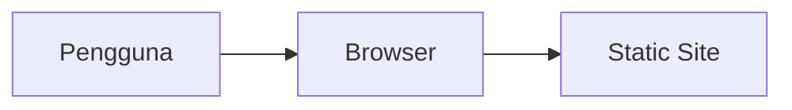

# Kontraktor Smartkos

Kontraktor Smartkos — project oleh Nabil Aulia Dika (dezzorigin).

## Status Proyek

**Dalam pengembangan** _(README ada)_

## 🌐 Live Demo

**https://7c0e93fa.kontraktor-smartkos.pages.dev**

## 📋 Tech Stack

HTML/CSS/JavaScript

## 🏗️ Arsitektur



## 📁 Struktur Proyek

```
assets/
Artemis_Proposal Business Plan - SmartKos.docx
LICENSE
PRD.md
README.md
business-plan-smartkos-unnamed.docx
business-plan_.docx
business_plan_smartkos.docx
business_plan_smartkos_d-f_lengkap.docx
business_plan_smartkos_fix.docx
daftar-peserta-dika.docx
daftar-peserta-fegi.docx
daftar-peserta-nisa.docx
dila-perencanaan.docx
dila-perencanaan.pdf
index.html
ktm-nabil-aulia-dika.pdf
naskah-presentasi-peta-konsep-problem-solving.pdf
prd.md
signature.png
whatsapp-image-2026-09-20-at-20.11.46.jpeg
```

## 🚀 Getting Started

```bash
# Install dependencies
npm install

# Jalankan development server
npm run dev
```

> Untuk project HTML/Python/Go, lihat instruksi di atas atau file konfigurasi.

## 📄 Lisensi

MIT — lihat [LICENSE](./LICENSE).

---
_Dikembangkan oleh **dezzorigin** (Nabil Aulia Dika)._
